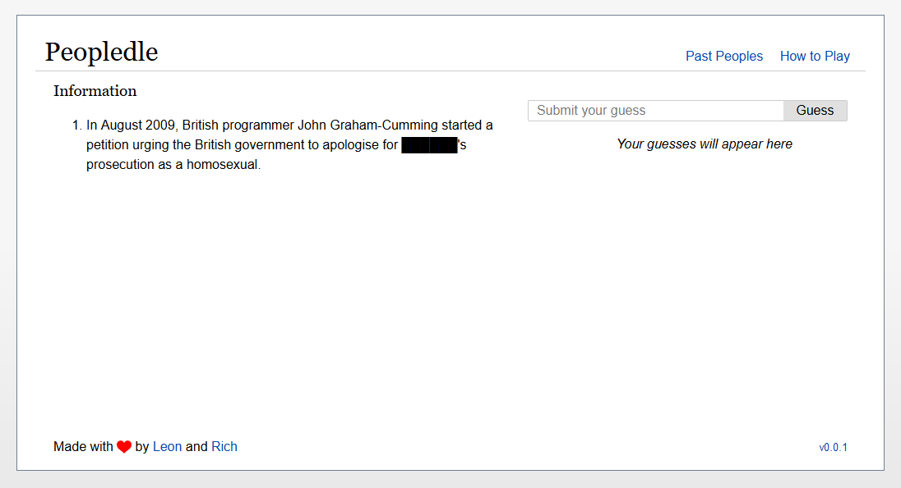

# Peopledle

Guess a person from clues drawn from their Wikipedia article. Each wrong guess reveals a more telling clue.

## Table of Contents

- [Overview](#overview)
- [Technologies](#technologies)
- [Getting Started](#getting-started)
- [How to Play](#how-to-play)

## Overview

I built this with Rich as a daily guessing game. It ranks article sentences with PageRank, then reveals them from less to more revealing. Browse previous people to play an older puzzle.

## Technologies

- [Flask](https://flask.palletsprojects.com/)
- [Waitress](https://docs.pylonsproject.org/projects/waitress/en/stable/)
- [NumPy](https://numpy.org/)
- [APScheduler](https://apscheduler.readthedocs.io/)
- [MediaWiki Action API](https://www.mediawiki.org/wiki/API:Main_page)

## Getting Started

The manifest targets Python 3.11 or later within 3.x. The source entry point is [`webserver.py`](webserver.py); it reads [`config.yml`](config.yml), has a Wikipedia data-preparation path, and binds to all interfaces. Review it before running on an isolated machine. A clean start and the hosted game's current availability weren't verified.

## How to Play

Read the first clue and submit a name. Continue guessing as clues are revealed, or choose **Past Peoples** for an earlier puzzle. Compare this older capture with the checked-in source if interface details differ.
